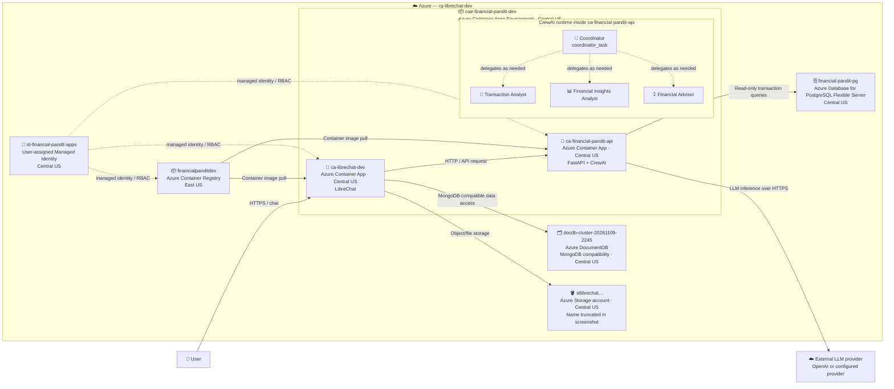

# Azure Architecture — `rg-librechat-dev`

This diagram is based on the Azure portal resource-group inventory shown in the supplied screenshot and the CrewAI task definition in `financial_pandit_agents/src/financial_pandit_agents/crews/content_crew/config/tasks.yaml`.

## Resource inventory

| Resource | Type | Location | Role |
|---|---|---|---|
| `ca-financial-pandit-api` | Azure Container App | Central US | Hosts the FastAPI and CrewAI financial-analysis API |
| `ca-librechat-dev` | Azure Container App | Central US | Hosts the LibreChat client/application |
| `cae-financial-pandit-dev` | Azure Container Apps Environment | Central US | Shared hosting environment for the Container Apps |
| `docdb-cluster-20261109-2245` | Azure DocumentDB with MongoDB compatibility | Central US | Document-oriented persistence for LibreChat or related application data |
| `financial-pandit-pg` | Azure Database for PostgreSQL Flexible Server | Central US | Relational financial transaction data used by the API |
| `financialpanditdev` | Azure Container Registry | East US | Stores container images used by the Container Apps |
| `id-financial-pandit-apps` | User-assigned Managed Identity | Central US | Passwordless identity for Azure resource access, such as image pulls |
| `stlibrechat…` | Azure Storage account | Central US | Storage for LibreChat/application objects; the suffix is truncated in the screenshot |

## Architecture diagram

## Relationship notes

- `ca-librechat-dev` and `ca-financial-pandit-api` are shown inside the shared `cae-financial-pandit-dev` Container Apps Environment.
- The API Container App contains the CrewAI runtime. The agents in `tasks.yaml` are logical agents inside the application process, not separate Azure resources.
- The coordinator decides whether to invoke the Transaction Analyst, Financial Insights Analyst, or Financial Advisor for each request.
- The PostgreSQL connection from the API and the DocumentDB/storage connections from LibreChat are architectural mappings based on the application/resource names and task responsibilities. Confirm the deployed environment variables and connection settings before treating these as verified runtime edges.
- The ACR image-pull and managed-identity edges are expected deployment relationships. Confirm the actual role assignments on `id-financial-pandit-apps` for the final security topology.
- The exact storage-account suffix is not legible in the supplied screenshot and is intentionally represented as `stlibrechat…` rather than guessed.
