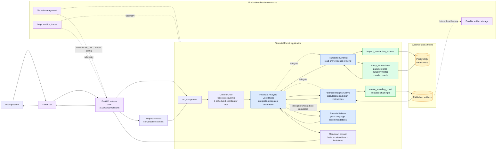

# Financial Pandit Architecture

The diagram shows the current CrewAI implementation and the next integration boundary for LibreChat and Azure. The specialist agents are dynamically delegated by the coordinator; they are not four fixed sequential tasks.

## Reading the diagram

- LibreChat sends the current user message and prior turns to the FastAPI adapter.
- `run_assignment` passes the question and request-scoped context to `ContentCrew`.
- The coordinator is the only scheduled task and is the only agent allowed to delegate.
- The Transaction Analyst is the only database-facing specialist.
- The Financial Insights Analyst works from supplied evidence and creates charts from validated values.
- The Financial Advisor explains implications and recommendations but does not query data.
- The database is an evidence source; the chart PNG is an output artifact.
- Azure services are shown as the production direction for secrets, observability, and durable artifact storage. They are deployment concerns around the current application, not additional agents.

## Current versus next state

| Area | Current implementation | Production direction |
|---|---|---|
| Client | Direct entry point and API tests | LibreChat using the OpenAI-compatible endpoint |
| Orchestration | One coordinator task with dynamic delegation | Flow wrapper for state, routing, retries, and review |
| Database | PostgreSQL via `DATABASE_URL` and read-only tools | Managed/private Azure PostgreSQL with operational controls |
| Charts | Local PNG artifacts | Durable artifact storage and response links |
| Configuration | `.env` values loaded locally | Managed secrets and deployment configuration |
| Operations | Logs and local validation | Azure monitoring, tracing, alerts, and health checks |
